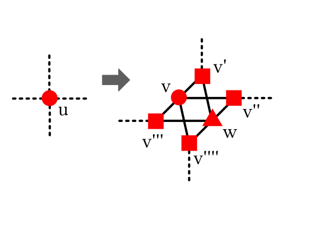
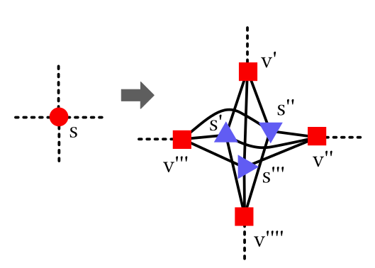

s-t Hamiltonian Path Notes
===


###### 2026-09-30

*(Overnight runs with Claude Code; details in the 2026-09-29 entry below.)*
*Illustrated explainer (private artifact): https://claude.ai/artifact/Db7V1quxqyetn28DGzV9dr
(source: `~/claude/runs/2026-09-30/explainer/`).*

Where things stand on extending Umans-Lenhart (UL) from Hamiltonian cycles to s-t paths:

1. **Why UL gets stuck on path-factors.** Instrumenting UL's existence argument (thesis
   Lemmas 6.3, 5.8, 6.4) on every stuck state: a good Type I border cell always exists, but
   the straight strip that should grow from it (Lemma 5.8, pure degree-2 forcing) always runs
   into $s$ or $t$. That happened in all 752 small-graph, 19,555 stretched and 3,071 13-cell
   (stuck state, $H$) pairs. Up to symmetry there are only two local configurations (the
   endpoint's single edge points outward, or forward).
   Figure: `~/claude/runs/2026-09-29/fig3_configurations.png`.
2. **Progress is still available, by UL's own measure.** UL's index (thesis Ch. 6) drops by 1
   for every improving-cell flip. Every stuck state has improving cells, and in **all 43,903**
   (stuck state, $H$) pairs tested (40,670 through 12 cells plus stretched, 3,233 at 13 cells)
   some *path cell* is improving. The improving path cell sits in a small fixed window next to
   where the forcing breaks.
3. **Conjecture:** in a strip-stuck path-factor, for every Hamiltonian s-t path $H$, some path
   cell near the point where UL's walk meets an endpoint is improving. It is local, so it
   should be provable by case analysis. Everything after it is UL's argument.
4. **A static algorithm** (`pful.py`): UL's algorithm as the thesis specifies (validated on
   2-factors), plus *borrow rounds* (flip a path cell, then UL only, never undoing the borrow),
   a *one-strip lookahead* inside a round, and bounded *reversal chains*. Results:
   * brute-force comparison (random 12-20 cells): all 1,173 Hamiltonian runs solved, all 78
     non-Hamiltonian runs stuck;
   * every recorded stuck state: 11,501 of 11,501 (exhaustive <= 12 cells, stretched,
     adversarial) and 2,448 of 2,448 at 13 cells; all but 18 needed at most one borrow round
     per step;
   * random 30-60 cell graphs (brute force too slow): 538 solved, never failing where the
     search-based solver succeeded; in 26 runs both failed (probably non-Hamiltonian, not
     certified).
5. **13-cell exhaustive** (61,064 graphs, 65.9 million multi-component factors): 2,448
   strip-stuck factors. Endpoint regions of at most 4 cells rescue 2,447. One needs a 6-cell
   region, the first exhaustive case where fixed-size endpoint gadgets fail. Even that one has
   deficit 1 (5 moves), satisfies the conjecture, breaks UL's argument at an endpoint, and is
   solved by the static algorithm.
6. **Proof progress (step 1, later on 2026-09-30).**
   * A purely local lemma is false. A mechanical check over all F patterns in a 4x4-cell window
     around $c$ (1.7 M for configuration A, 2.0 M for B), letting the adversary pick any
     locally balanced $S = F \oplus H$, always finds small $S$-cycles that fence $c$ off from
     every candidate cell (`pflocal.py`). So the proof must use global structure.
   * **Acyclicity of the dependency graph for path-factors: proved.** Discrete Stokes: the
     circulation around a dual cycle equals the sum of the local circulations of the enclosed
     vertices (interior arcs cancel; in a solid graph every enclosed vertex has all four cells
     around it). The local circulation is $\pm(4 - 2\deg)$, verified exhaustively over all 16
     edge patterns at a vertex and both parities. So it is 0 except $\pm 2$ at $s$, $t$. A
     directed cycle of length $L \ge 4$ has circulation $\pm L$; a 4-cycle encloses one vertex
     ($|{\rm circ}| \le 2$) and longer cycles would need $\ge 6 > 4$. (UL's Lemma 4.3 proof uses
     degree 2 and does not apply at endpoints.)
   * **The continued Phase II walk ends at improving cells: proved, given a good Type I cell $c$.**
     Follow dependency arcs from $c$, in the direction of the arc across $c$'s dark edge. A
     directed walk crosses an alternating cycle only in the direction of its arcs (thesis
     Lemma 4.5), so it stays inside $c$'s $+$ cycle and never enters a $-$ cycle. It leaves $c$
     ($c$ is not alternating, so its arcs are not uniform). By acyclicity it terminates at a
     cell whose four arcs all point inward, which is exactly an alternating cell, inside a $+$
     cycle with matching arcs, i.e. an improving cell. In 2-factors this walk is UL's straight
     strip; at an endpoint it bends around the defect.
   * **Empirically the walk's terminals are also path cells:** every terminal is alternating,
     improving and a path cell in all 752 + 3,071 + 3,928 (exhaustive <= 12, 13-cell,
     stretched) (stuck state, $H$) pairs, with 1-2 terminals per walk. The terminals do not
     always touch the endpoint (about 60% do), so being a path cell must come from more than
     sharing $e$'s edge. Open: prove this (it must use strip-stuckness: no Type III cells means
     both dark edges are on one component; the question is why that component is the path).
   * **Open: Lemma 6.3 for path-factors** (a good Type I cell exists). Its proof walks along a
     boundary of Type I/II cells; always true in the data (0 exceptions), not yet re-proved.
   * Walk terminals from *all* Type I border cells are computable from $F$ alone, so they give
     an $H$-free candidate set that contains an improving cell.
   * **Hunt finding (algorithmic, not a conjecture failure):** a 44-cell generated instance where
     the static algorithm fails. The conjecture holds (5 improving cells, all path cells), but
     no single path-cell borrow followed by strips/non-raising cells makes progress. The
     rescue needs two borrow/repay rounds, the first at path distance 17.
7. **Afternoon of 2026-09-30.**
   * **Lemma 6.3 (Type IV case), by hand.** UL's Lemma 5.1 argument still works whenever the
     border edge's corners are not endpoints, and gives a Type III neighbour. With exactly one
     endpoint $u$ among the Type IV cell's corners, the other three corners share a component
     $K \ne$ path, and the cell beside $u$'s single edge is either a Type III cell or forces
     $u$ into $K$; contradiction either way. So in a stuck state a Type IV border cell needs
     **both** endpoints as corners. That is the only unresolved configuration. Exhaustive check
     up to 10 cells: 3,482 path-factors have a Type IV border cell whose corners include both
     endpoints; 3,340 are not stuck, and all 142 stuck ones are non-Hamiltonian. So in
     Hamiltonian instances the exception never produced a stuck state; it looks like a
     certificate of non-Hamiltonicity rather than a gap.
   * **Path-cell property: local evidence.** In ordinary (non-stuck) states, a walk from an
     endpoint-blocked Type I cell ends at a *loop* cell 46 times, and each time an improving
     strip sits within distance 3 of it (mostly 2). Stuck states never produce a loop terminal.
     Likely proof route: a finite local case analysis showing "loop terminal implies a nearby
     improving strip", i.e. not stuck. A purely geometric argument about path distance can't
     work: the walk is only 2-3 arcs long, but the terminal's edges can be 12+ path steps from
     the endpoint.
   * **Path-cell property, configuration B: proved for walks that stay local.** Enumerating
     all 2.0 M $F$ patterns in the 4x4-cell window (configuration B): whenever the continued
     walk from $c$ ends inside the window, the end cell has at least one $F$ edge in the same
     window-connected piece as the endpoint, hence on the path. With no Type III cells its
     other $F$ edge is on the path too, so it is a path cell. Configuration A has 294 k of
     1.7 M patterns where the end cell is not tied to $e$ inside the window, so A needs a
     global argument. In both configurations some walks leave the window; real walks are
     2-3 steps long, but a proof must bound them.
   * **Path-cell property, configuration A: reduced.** In the 4x4 window, terminals at
     (1,1), (1,2), (2,2) (forward, outward offsets from $c$) are always tied to $e$, hence path
     cells. The only untied terminals sit at (2,0) and (2,1) (294 k patterns), and every one is
     tied instead to $c$'s *other* leading corner $o$. So configuration A reduces to: *if the
     walk ends at (2,0)/(2,1) untied to $e$, then $o$ is on the path.* (Unconditionally, $o$ is
     on a loop in 20 of 3,345 real configuration-A states, but there the terminal is one of the
     $e$-tied kinds.) The census also shows a third configuration: **both** endpoints are
     leading corners of $c$ (397 states). Catalogued: in all 397, one endpoint's edge points
     forward and the other's outward (A and B superimposed). In 395 the walk ends at the
     diagonal cell (1, +-1), one of whose $F$ edges ends at an endpoint, so it is a path cell
     given no Type III. The other 4 end at (2,0)/(2,1), the same leftover positions as in A.
     **Summary of the path-cell property:** proved locally whenever the walk ends next to the
     break (diagonal or forward-outward cells, and all of configuration B inside the window).
     What remains, in every configuration, is the terminals two cells ahead at (2,0)/(2,1),
     which are tied to $c$'s other leading corner rather than to an endpoint. For those
     (configuration A, 294 k local patterns): assuming $o$ is on a loop, 223 k patterns
     contain an alternating cell with one $F$ edge tied to $e$ and one tied to $o$, i.e. a
     Type III cell. That contradicts stuckness, so $o$ is on the path and the terminal is a
     path cell. **71 k local patterns remain** without a contradiction inside the 4x4 window.
     Extending each residual by one ring (6x6 window, `pflocal2.py`; sample of 400, 2.5 h on
     8 cores): 242 (60%) become contradictory in every extension, 158 (40%) still have a
     consistent extension. Scaled up, about 28 k patterns stay open even at 6x6, so the last
     piece needs a global argument (the path's connectivity, or stuckness beyond "no Type III
     cells"), not a bigger window.
   * **Walk terminals as borrow candidates** (`pful.CANDIDATES = "walk"`): identical results to
     path cells on all 13,948 recorded stuck states (13,931 need one round, 17 need two).
   * **Targeted hunt** (`pfhunt2.py`): seeds are all recorded obstructions, grown by splicing
     edges in both $F$ and $H$ (which preserves the obstruction), then perturbed. 60,000 runs
     (mean 41 cells, max 124) met **24,244 stuck states** (versus 461 in 57,000 random runs).
     The conjecture and the walk claim (some walk terminal is improving) held in **all
     24,244**.
   * **Debt 1 is not always enough.** Two targeted-hunt states (20 and 29 cells) need
     **deficit 2**: no rescue with only one extra loop exists (exhaustive at peak +1, strips
     and single cells). The 20-cell rescue flips the unique improving cell (a path cell and a
     walk terminal), then the next walk terminal, then a Type III cell, then two strips. Every
     move lowers UL's index (-1, -1, -1, -2, -2) while the loop count goes 2, 3, 4, 3, 3, 1.
     So the component count is the wrong currency; the index is the right one.
   * **Index-guided walk chains** (`pful.walk_chain`): when UL is stuck, flip a walk terminal
     and rerun UL, never re-flipping a chain cell (otherwise UL undoes it, since a flipped
     terminal is typically Type III), and recurse up to depth 3. The loop count is not
     bounded. This solves both deficit-2 cases and the 44-cell three-round case, all at
     depth 3.
   * **A simpler algorithm: UL plus walk chains only** (no path cells, borrow rounds, lookahead
     or reversal chains; every ingredient justified by Lemmas A and B). Against brute force it
     solves all 1,173 Hamiltonian runs and leaves all 78 non-Hamiltonian runs stuck. (The
     run over all recorded stuck states is reported below.)
   * **UL + walk chains, targeted hunt** (100,000 runs, growth up to 80 splices, perturbations
     up to 16 flips, mean 64 cells): **all solved**; 29,007 stuck states met; conjecture and
     walk claim held in all. Walk-chain depth used: 1 (25,557), 2 (3,430), 3 (19), 4 (1). The
     depth-4 state (28 cells) has a deficit-1 rescue of 6 moves (including a 3-cell strip) that
     the chain, which only flips walk terminals between UL runs, reaches by a longer route.
     Running total for the conjecture: 43,903 + 24,244 + 29,007 + 461 checks, no failures.
   * **UL + walk chains on large random instances** (`pfhunt.py`, PURE=1): 28,733 instances,
     mean 148 cells, up to 481; **86,199 of 86,199 runs solved**; 653 stuck states met, the
     conjecture held in all (so 1,114 of 1,114 over both random hunts).
   * **Iterated targeted hunt** (`pfhunt2.py` with SAVESTUCK: each generation is seeded with
     the stuck states the previous one found, then grown and perturbed again; UL + walk
     chains, depth cap 6):

     | generation | runs | mean cells | stuck states | conjecture + walk claim | depth 1 / 2 / 3 / 4 |
     |---|---|---|---|---|---|
     | 1 | 40,000 | 45 | 14,824 | all | 13,104 / 1,712 / 8 / 0 |
     | 2 | 40,000 | 53 | 16,139 | all | 13,942 / 2,180 / 16 / 1 |
     | 3 | 40,000 | 65 | 17,616 | all | 14,889 / 2,691 / 36 / 0 |

     | 4 | 40,000 | 109 | 15,894 | all | 13,235 / 2,612 / 47 / 0 |
     | 5 | 40,000 | 139 | 19,994 | all | 16,460 / 3,446 / 88 / 0 |

     | 6 | 39,978 | 191 | 25,875 | all | 21,219 / 4,505 / 151 / 0 |

     All 239,978 runs solved (generations 4-6 allow up to 80 splices of growth). Depth 3 gets
     slowly more common as the graphs grow (8, 16, 36, 47, 88, 151 uses); the maximum stays at 3,
     with depth 4 once. (Generation 6 first failed: the parent held ~20k seed states as networkx
     graphs, about 3.6 GB, which every forked worker inherited against its 3 GB cap. Fixed by
     storing seeds as vertex/edge tuples and building graphs in the workers.)
     Running total for the conjecture: **208,610 of 208,610** (stuck state, $H$) checks.
8. **Still open:** proofs of Lemma 6.3 for path-factors (only the both-endpoints Type IV
   case) and of the path-cell property of the walk terminals (configuration A, and walks
   leaving the local window); a bound on walk-chain depth;
   a static characterisation of reversal chains
   (currently a bounded search); whether one or two borrow rounds per step always suffice;
   and a polynomial bound for the full algorithm with lookahead and reversal chains.

---


###### 2026-09-29

*(Experiments in this entry were run with Claude Code; the harness is `pfharness.py` in this directory.)*

Picking up the "Aside, setting up initial path and loops" idea from 2025-07-09:
instead of a 2-factor, start from a *path-factor* and try to run the UL merge
machinery on it.

* A *path-factor* $F$ of $G$ (with respect to $s$, $t$) is a spanning subgraph with
  $\deg(s) = \deg(t) = 1$ and every other vertex degree 2.
  It's always one $s$-$t$ path plus zero or more disjoint cycles.
* A Hamiltonian $s$-$t$ path is exactly a path-factor with one component.
* Flipping an alternating cycle $C$ ($F \oplus C$) keeps every degree, so a path-factor
  stays a path-factor. The only thing that changes is the component count.
  More generally, $F \oplus D$ keeps degrees whenever every vertex of $D$ has as many
  $F$ edges as non-$F$ edges in $D$ (call $D$ *balanced*).

The initial path-factor is found with the widget/matching construction from the
2025-07-09 addendum (degree-$b$ vertex gets $b$ internal widget vertices, so $s$ and $t$
get one), cross-checked against a plain bipartite flow. The two always agree.

A single type `III` cell merging a cycle into the path (`#` is the cell):

```
  F: path + one 4-cycle           F xor cell: one component

  *---* . *---*---*               *---* . *---*---*
  |   |   |   '   |               |   |   |   '   |
  *---* . * . *---*               * . * . * . *---*
  ' # '   |   |   '               |   |   |   |   '
  *---* . * . *---*               * . * . * . *---*
  |   |   |   '   |               |   |   |   '   |
  s . *---* . t---*               s . *---* . t---*
```

**Check against brute force.** For small random solid grid graphs (12-20 cells),
an exhaustive DFS decides whether a Hamiltonian $s$-$t$ path exists.
On the Hamiltonian instances, run a UL-style solver from random starting path-factors:
flip improving strips (component count drops); when there are none, BFS over
neutral strips (count unchanged, UL's even strips) until an improving one shows up.
If that BFS runs out of states, the factor is provably stuck under strip moves.

**Finding 1: strips alone are not enough, even with $s$, $t$ on the outer face.**
Some Hamiltonian instances get stuck (13 / 20 / 8 of ~2,500 runs at 12 / 16 / 20 cells),
and some are stuck from the starting factor, i.e. no sequence of strip moves works at all.
Every stuck state had the leftover cycle within one step of an endpoint.
Example (both endpoints on the outer face):

```
  stuck F: no strip moves at all          a Hamiltonian path

          *---*---*                               *---*---*
          |   '   |                               |   '   |
  *---* . *---* . *                       *---*---* . *---*
  |   |   '   |   |                       |   '   '   |   '
  *---* . s . * . *---*                   *---*---s . * . *---*
          |   |   '   |                           '   |   |   |
          * . *---* . t                           *---* . * . t
          |   '   |                               |   '   |
          * . *---*                               * . *---*
          |   |                                       |   |
          *---*                                       *---*
```

The 4-cycle on the left can only be merged through the cell between it and `s`, and
that cell only becomes type `III` if `s`'s single edge points up instead of down.
Re-aiming an endpoint's edge with single-cell flips needs the component count to
go *up* first (2 -> 3 -> 4 -> 3 -> 2), which UL's scheme never allows.
With 2-factors there are no degree-1 vertices, so this never comes up.

Composing those four uphill cell flips gives one count-neutral move: the boundary of
the 2x2 block of cells next to `s`, which alternates and passes through `s`:

```
          * . * . *
          '   '   '
  * . * . *---*---*
  '   '   |   '   |
  * . * . s . * . * . *
          |   '   |   '
          *---*---* . t
```

**Finding 2: small balanced cycles through an endpoint fix it.**
Add as moves: the boundary of any hole-free region of $\le K$ cells that passes through
$s$ or $t$ and is balanced (equal $F$ / non-$F$ edges at each vertex).
Corner-pinched regions are allowed. One case needed a unit cell at $s$ joined at a corner
to a 2x2 block surrounding $t$, flipped as a figure-8.
Keep UL's rule of only neutral or improving moves.

| sweep (paired, same instances) | strips only | + rectangles $\le$ 3x3 | + regions, $K = 4, 5, 6$ |
|---|---|---|---|
| 300 trials x 12 cells | 13 stuck | 3 | 0, 0, 0 |
| 300 trials x 16 cells | 20 stuck | 0 | 0, 0, 0 |
| 300 trials x 20 cells | 8 stuck | 2 | 0, 0, 0 |

$K = 4$ is already enough in everything tried. Rectangles alone leave a few,
simple (unpinched) regions up to 9 cells leave one, and pinched regions clear it.

**Exhaustive check up to 12 cells** (`pfexhaust.py`).
Every solid grid graph with $\le 12$ cells (up to the 8 symmetries of the square),
every parity-compatible $\{s,t\}$ pair (up to symmetry) that admits a Hamiltonian path,
and *every* path-factor with $\ge 2$ components. For each factor, is there a sequence
of neutral moves followed by an improving move, and what's the smallest region size $K$
that allows it ($K=0$: strips only)? If every such factor can make progress, induction
on the component count gets from any path-factor to a Hamiltonian path.

| cells | multi-component factors | stuck with strips only | rescued, $K \le 4$ | min $K$ = 1 / 2 / 3 / 4 |
|---|---|---|---|---|
| $\le 9$ | 172,848 | 0 | - | - |
| 10 | 660,337 | 12 | 12 | 1 / 6 / 1 / 4 |
| 11 | 3,099,952 | 98 | 98 | 8 / 51 / 7 / 32 |
| 12 | 14,385,087 | 537 | 537 | 46 / 290 / 34 / 167 |

No failures, no search hit its state cap, and nothing needed more than 4 cells
(up to 6 was allowed).
Through 9 cells, UL strips alone always work. The smallest obstructions are at 10 cells,
and all 12 of them are the $s$-$t$ path plus a single pendant square next to an endpoint.
One endpoint move followed by one or two strips always finishes.

Smallest example with both endpoints on the outer face (10 cells):

```
  stuck: no strip helps         flip 2x2 boundary through s      then one type III cell
                                (count unchanged)

          *---*---*                     * . * . *
          |   '   |                     '   '   '
          * . *---*                     *---*---*
          |   |   '                     |   '   |
  *---* . s . * . t             * . * . s . * . t
  |   |   '   |   |             '   '   |   '   |
  *---* . *---* . *             * . * . *---*---*
          |   '   |                     '   '   '
          *---*---*                     * . * . *

  result: Hamiltonian path

          *---*---*
          |   '   |
          *---* . *
          '   |   |
  *---*---s . * . t
  |   '   '   |   '
  *---*---* . *---*
          |   '   |
          *---*---*
```

The endpoint move comes in a handful of small shapes: 1x1 (a single count-neutral cell
containing an endpoint, i.e. a path *reversal* cell), 1x2, 2x1, 2x2, L-shaped 3/4-cell
regions, and corner-pinched 2/4-cell regions.

**Does it depend on how far apart $s$ and $t$ are?**
In small graphs $s$ and $t$ are always close, and some rescuing moves pass through
*both* endpoints, which can't stay small if they're far apart. Splitting the 647
obstructions from the exhaustive runs (10-12 cells):

| | type A: fixed at one endpoint | type B: needs both endpoints |
|---|---|---|
| count | 504 | 143 |
| $\lvert s-t \rvert$ | 1 to 6 (the full range in these graphs) | 2 (140 cases) or 4 (3 cases) |
| leftover loop distance to nearer / farther endpoint | 1 / anywhere up to 7 | 1 / $\le$ 4 |
| move size needed | $\le$ 5 cells, through that endpoint only | $\le$ 4 cells, through both |

Type A: a small loop (4, 6 or 8 vertices) next to one endpoint, fixed locally there,
wherever the other endpoint is. Type B: a small loop wedged between two endpoints
that are 2 apart. So far the coordinated moves only show up when $s$ and $t$ are close.

Random runs with $s$, $t$ picked among the farthest-apart valid pairs
(`pfscale.py --far`; 20 / 30 / 40 cells, mean $\lvert s-t \rvert$ of 8.7 / 10.0 / 11.5,
about 580 Hamiltonian instances x 4 starting factors) found *no* obstructions at all,
even with strips only. A same-size control (30 cells, ordinary endpoints) found 2,
both of type A. One of them was 7 apart, with the loop next to $t$ and 8 steps from $s$,
fixed by two small pinched regions at $t$.

Working picture: strips, plus a small endpoint gadget at a single endpoint, plus a
two-endpoint gadget only when $s$ and $t$ are within a few steps of each other.

**Debt and payback instead of gadgets** (`pfdebt.py`).
Rather than cataloguing region shapes, allow a temporary *deficit*: moves may raise the
component count, as long as the sequence ends below where it started. Minimise the peak
(bottleneck search). Over all 647 strip-stuck factors from the exhaustive runs:

| moves allowed | deficit 0 | deficit 1 | deficit 2 | moves needed |
|---|---|---|---|---|
| single-cell flips only | - | 444 | 203 | 4-7 |
| UL strips + single-cell flips | 55 | **592** | **0** | 2-4 |

So with UL's own primitives (strips and single cells), **one unit of debt is always enough**.
The deficit-0 cases use a count-neutral single-cell flip, i.e. a path reversal, which
UL's strips don't include. Every flipped cell is within 2 steps of an endpoint, and
this holds for every $\lvert s-t \rvert$ available (1-6).

Typical borrow / repay / progress (10 cells):

```
  start: 2 components            1) borrow: cell # splits a loop off (2 -> 3)

  *---*---*                      *---*---*
  |   '   |                      |   '   |
  *---* . *                      *---*---*
  '   |   |                      '   '   '
  s . * . t . *---*              s . *---t . *---*
  |   |   '   |   |              |   |   '   |   |
  * . *---* . *---*              * . *---* . *---*
  |   '   |                      |   '   |
  *---*---*                      *---*---*

  2) repay: 3-cell strip (3 -> 2)   3) progress: type III cell (2 -> 1)

  *---*---*                      *---*---*
  |   '   |                      |   '   |
  *---*---*                      * . *---*
  '   '   '                      |   |   '
  s---* . t---*---*              s . * . t---*---*
  '   |   '   '   |              '   |   '   '   |
  *---* . *---*---*              *---* . *---*---*
  |   '   |                      |   '   |
  *---*---*                      *---*---*
```

The region moves above (dominoes, L's, T's, pinches) look like what these short
borrow/repay sequences add up to.

**Stretching breaks fixed-size regions but not debt $\le 1$** (`pfstretch.py`).
Take a stuck factor, insert $k$ columns (or rows) at a cut and lift $F$. Stuck-ness
survives stretching. In one family, the region needed grows with the stretch
(6 cells at $k=4$, more than 6 at $k=8$, with $s$, $t$ 10 apart along a corridor),
but debt-and-payback still takes 3 moves at any $k$:

```
  borrow at t: one cell, 2 -> 3        repay + progress at s: two 2-cell strips, 3 -> 1
  (cuts the corridor off as a loop)    (merges corridor loop and leftover square)

            * . *                                 * . *
            '   '                                 '   '
        t---* . * . *                         t . * . * . *
        |   |   '   '                               ...
        *---* . * . *                 * . *---*---* . * . *
            ...                        '   |   '   |   '
  (corridor, 8 rows)                   * . *---s---* . *     then
            ...                        '   '   '   '
  * . * . s . * . *                    * . *---s---* . *
                                       '   |   '   |
                                       * . *---*---*
```

Each move is local (every flipped cell touches an endpoint), but the borrow happens
at $t$ and the repayment at $s$, 10 apart, joined only by the temporary extra component.
This is the "two half moves, both endpoints involved" picture. A region move has to cover
everything between them at once; debt-and-payback does it as two local actions.

**Full stretch results.** 647 obstructions, every cut, $k = 2, 4, 8$: 9,954 stretched
factors stay strip-stuck (all certified Hamiltonian; graphs up to 60 cells,
$\lvert s-t \rvert$ up to 14). Region moves of $\le 4$ cells still rescue almost all,
but a few families need regions that grow with $k$, and both-endpoint cases now occur
at $\lvert s-t \rvert$ = 6, 8, 10, 12. Debt search (UL strips + single cells), all 9,954:

| | count |
|---|---|
| deficit 0 | 1,294 (+2 of the 9 that first hit the search cap) |
| deficit 1 | 8,651 (+7) |
| deficit $\ge 2$ | 0 |

Moves needed: 2-7 (one case 11). **Debt $\le 1$ held on everything.**

**But not always near an endpoint.** In 430 cases the sequence found flips a cell 3-10
steps from both endpoints. Re-searching with every move required to be within 2 steps
of an endpoint: 428 still work (deficit $\le 1$, 3-6 moves), so the far flips were just how
the search broke ties (e.g. cutting a long two-strand corridor at its far end instead of
next to $t$). The other 2 are one family (a 12-cell case stretched by $k=4$ and $k=8$) that
really needs a far move. The path snakes through the stretched region, and the only borrow
that works is at the serpentine's far U-turn, at distance 5 ($k=4$) or 9 ($k=8$) from both
endpoints. Inside a serpentine, flipping a cell between neighbouring strands only reverses
part of the path; only the far end cuts it off as a loop:

```
  borrow at the far U-turn # (2 -> 3)          then 3 moves at s / t (3 -> 2 -> 3 -> 1)

                          *---t                                          *---t
                          |   '                                          |   '
  *---*---*---*---*---*---* . *---*          *---*---*---*---*---*---* . *---*
  |   '   '   '   '   '   '   |   |          |   '   '   '   '   '   '   |   |
  *---*---*---* . *---* . s . *---*          * . *---*---* . *---* . s . *---*
  ' # '   '   |   |   |   |   '              |   |   '   |   |   |   |   '
  *---*---* . *---* . * . *---*              * . *---* . *---* . * . *---*
  |   '   |   '   '   |   '   |              |   '   |   '   '   |   '   |
  *---* . *---*---*---* . *---*              *---* . *---*---*---* . *---*
      |   '   '   '   '   |                      |   '   '   '   '   |
      *---*---*---*---*---*                      *---*---*---*---*---*
```

So the number of moves and the debt stay bounded (1 unit, 4 moves at any $k$), but the
borrow location is not bounded in distance from the endpoints. It sits at a structural
feature of the path (where it doubles back), not a geometric one.

**How every rescue connects to $s$ and $t$.** Compose each rescuing debt sequence into
its net change $D = F \oplus F'$ (balanced at every vertex). Over all 10,592 rescues
(647 exhaustive + 9,945 stretched), with no exceptions:

* $D$ has a piece that **passes through $s$ or $t$** (8,964 + 572 cases) or
  **encloses $s$ or $t$** without touching it (981 + 75); and
* any other pieces of $D$ (1,313 of them, e.g. the far U-turn in the serpentine family)
  **cut the $s$-$t$ path**: every $F$ edge they remove is a path edge, never a loop edge.

So the deficit moves are always tied to the endpoints, either geometrically
(touching or winding around them) or through the path that ends at them. The "chain" is
the path itself. Candidate static formulation: *borrow* = cut the $s$-$t$ path at a cell
whose two $F$ edges are both path edges (splitting a loop off the path); *repay* = a
UL-type flip whose net effect passes through or encloses an endpoint. Borrow sites can be
listed by walking the path, and repayments are anchored at $s$ or $t$, much as borders
anchor UL's strip chains.

**A static borrow rule** (`pfborrow.py`). *Path cell*: an alternating cell whose two
$F$ edges are both on the $s$-$t$ path; flipping it cuts a loop off the path (+1) or
reverses a path segment (0). Rule: borrow at the path cell nearest an endpoint
*measured along the path*, then use UL moves only (strips, plus single cells that don't
raise the count). Over all 10,601 obstructions:

| | exhaustive (647) | stretched (9,954) |
|---|---|---|
| nearest path cell works | 624 | 9,140 |
| 2nd / 3rd nearest works | 23 | 811 |
| borrow at path distance 0 / 1 / 3 | 634 / 13 / 0 | 9,684 / 264 / 3 |
| no single path-cell borrow works | 0 | 3 |

The 3 are one family (a vertical serpentine at $k = 2, 4, 8$). It needs two borrow/repay
rounds, both at path cells, at path distances 6 and 3 at every stretch, deficit never
above 1. So the borrow is anchored to an endpoint *along the path*, and after it UL's own
moves do the rest. In the snake example the repayment is an ordinary type-III cell at the
far end of the loop that the borrow cut off; the non-local part is just UL following that
loop. Figures: `~/claude/runs/2026-09-29/fig1_concepts.png` (path vs loops, dependency-graph
defect at $s$, path cells numbered by path distance) and `fig2_rule_steps.png` (the rule
step by step).

**UL's own progress measure says the borrow is progress** (`pfindex.py`; from the thesis,
Ch. 4-6). UL's existence proof measures progress with the *index*
$I(F, S) = \sum_{\text{cells}} \sum_{C \in S \text{ enclosing it}} \pm 1$, where $S$ splits
$F \oplus H$ ($H$ Hamiltonian) into non-crossing alternating cycles, oriented by nesting
and by the direction of the dependency arcs crossing them (Def 6.1-6.3; UL97's $d(F,H)$).
An *improving cell* (Def 6.5) is an alternating cell just inside a $+$ cycle whose crossing
arcs point the same way as that cycle's; flipping it lowers the index by exactly 1
(Lemma 6.2). UL's strips are runs of improving cells; an even strip's first flip raises
the component count (Lemma 5.5) and later flips bring it back, so a "deficit" is already
inside every even strip.

Validated on 2-factors against Hamiltonian cycles: 0 Lemma 4.4 violations, and all 158
improving-cell flips lowered the index by exactly 1. For path-factors ($F \oplus H$ is still
even everywhere, $s$ and $t$ included), over all rescue chains:

| | exhaustive (647 chains) | stretched (9,945 chains) |
|---|---|---|
| Lemma 4.4 violations in the stuck state | 0 | 0 |
| borrow cells that are improving cells | 669 / 669 | 9,894 / 9,894 |
| every move lowers the index by its number of cells | all chains | 9,770 (175 have one count-neutral cell with +1) |
| improving cells present in the stuck state | 1-3 | 1-5 |

So stuck states *do* contain progress by UL's measure; UL's machinery just can't reach it.
Strips are how UL certifies an improving cell without knowing $H$: the walk from a Type I
border cell (Lemmas 5.8, 6.3, 6.4) relies on degree-2 forcing, which fails at $s$ and $t$.

**Improving cells are path cells.** Checking against several Hamiltonian paths per stuck
state (exhaustive enumeration for small graphs), every improving cell was a path cell
(1,263 of 1,263 in the exhaustive set). The particular path cell a fixed rule picks is not
improving for every $H$ (708 of 770 state/$H$ pairs), but the set of path cells is
$H$-free and contains every improving cell. So "try each path cell as the borrow" covers
whichever $H$ exists.

Stretched set (about 4 Hamiltonian paths per stuck state, up to 30): 97 of 193,799
improving cells were not path cells. All 97 came from 3 states, were cells with both $F$
edges on the same leftover loop, and in each such (state, $H$) pair an improving path cell
also existed. The per-$H$ check:

| | (state, $H$) pairs | with an improving cell | with an improving **path** cell |
|---|---|---|---|
| exhaustive | 770 | 770 | 770 |
| stretched | 39,900 | 39,900 | 39,900 |

**Conjecture (path-factor analogue of thesis Lemmas 6.3-6.4).** *If $F$ is a strip-stuck
path-factor of a solid grid graph and $H$ is a Hamiltonian $s$-$t$ path, then some path
cell (an alternating cell whose two $F$ edges both lie on the $s$-$t$ path) is an improving
cell with respect to $(F, H)$.*

**Where UL's argument breaks** (`pflemma.py`). Instrumenting thesis Lemmas 6.3 (a good
Type I border cell: on the immediate interior of a $+$ cycle, dark edge crossed by an arc
oriented like that cycle's), 5.8 (a strip grows straight from it by degree forcing) and
6.4 (it ends at an improving cell), on every exhaustive stuck state against up to 3
Hamiltonian paths each (752 pairs):

* Lemma 6.3 always holds: a good Type I cell exists.
* Lemma 5.8 always fails, and in every case the strip's line runs into $s$ or $t$.
* The improving path cell sits at distance 0-1 from the failing line (2 in one case).

The local picture, with the strip growing in the $+x$ direction from the good Type I
cell $c$ (dark edge on its left): in 645 of 647 states the endpoint is a leading corner of
$c$ itself. That is exactly where UL's forcing breaks: $c$ has three light edges, so in a
2-factor each leading corner must take both its outward and its forward edge, forcing the
next cell's pattern, while an endpoint takes only one. Up to mirror symmetry:

| configuration | improving path cell, (forward, outward) offset from $c$ |
|---|---|
| A: endpoint's $F$ edge points outward (689 pairs) | (1, 1) in 629; else (1, 2) and (2, 0) (56) or (2, 1) (4) |
| B: endpoint's $F$ edge points forward (61 pairs) | (1, -1) in 61 of 61 |

(The other 60 pairs have the endpoint two cells further along the line; not yet
catalogued.) The stretched set agrees: all 19,555 (stuck state, $H$) pairs break at
Lemma 5.8 with the line running into an endpoint, with the improving path cell at distance
0 (9,375), 1 (10,169) or 2 (11) from the failing line. On a sample of 600 stretched pairs,
every one is configuration A (551) or B (49), with an improving path cell inside the window
above. Here (1, 1) is the cell sharing the endpoint corner, one step forward and one
outward; (1, -1) is the cell forward of $c$ on the other side of the strip row. So in the
small graphs, when the forcing breaks at an endpoint, an improving path cell sits within a
few cells of the break. A statement that local should be provable by case analysis.

**Adversarial instances** (`pfadv.py`), not derived from a single stretch:
two exhaustive obstructions glued end to end ($t_A$ adjacent to $s_B$, path
$s_A \to t_A \to s_B \to t_B$), and stretched obstructions stretched again along the other axis.

| | stuck + Hamiltonian | improving path cell for every $H$ tried | one borrow round works (path distance) |
|---|---|---|---|
| glued (3 components each) | 341 | 341 | 341 (0: 338, 1: 3) |
| double-stretched | 559 | 559 | 559 (0: 532, 1: 26, 3: 1) |

**A static algorithm** (`pful.py`). UL's algorithm implemented as the thesis specifies
(Ch. 8: Type III check; auxiliary graph with BEGIN/CHAIN/ODD/EVEN nodes; links via shortest
paths in the dual minus $F$; shortest BEGIN-to-ODD path). Validated on 2-factors against
brute force: 860 of 860 runs on Hamiltonian graphs solved, all non-Hamiltonian runs stuck.
Changes needed for path-factors:

* *Verify strips when building the auxiliary graph.* The thesis skips this because degree
  forcing guarantees the pattern (Sec 8.1.4); at $s$, $t$ it does not, and unverified strips
  made the shortest path invalid.
* *Borrow rounds.* When UL finds no sequence: flip a path cell (in path-distance order),
  then UL sequences only, with the borrowed cell excluded. Otherwise UL's shortest sequence
  is to flip it straight back, since it is now a Type III cell. A round may end neutral, and
  up to 2 rounds are allowed before the count must drop. Also accept an even strip that
  merges (after a borrow one strip can merge the borrowed loop and another loop, -2), and one
  extra non-raising path-cell flip per round.

Against brute force on random solid graphs (12-20 cells, 3 starting factors each): 1,157
runs solved by UL alone, 14 of the 16 runs where UL gets stuck solved by the extension, the 78
non-Hamiltonian runs correctly stuck, 2 Hamiltonian runs unsolved. From the recorded
strip-stuck states, all the way to a Hamiltonian path: exhaustive 646 of 647 (578 with one
borrow round per step, 68 needing two). Stretched and adversarial results are further down.

The remaining failures needed two more ingredients, both bounded:

* *Non-static repayments (one-strip lookahead).* All 9 remaining stuck-state failures
  (exhaustive case 367 and its stretches) and one random case have the same repayment
  after the borrow: a neutral 2-cell strip, then a strip that merges two components.
  The second strip's end cell only becomes alternating after the first strip is flipped,
  because the two share an edge the static definition forbids. So no static sequence
  exists. In 2-factors, UL's Theorem 10 guarantees one does (via Lemmas 7.1-7.2, which end
  with "contradicting F being a 2-factor", another degree-2 step that fails at an endpoint).
  After it, the needed move is a Type III cell, UL's own terminal case (Lemma 5.7). Fix:
  inside a borrow round, when UL's static search fails, try each verified neutral strip
  once and rerun UL (polynomially many extra UL searches).
* *Reversal chains.* One random case needs four successive count-neutral path-reversal
  flips, each exposing the next, before a strip can finish: a "strip" running along the
  path rather than straight across cells. Handled for now by a bounded search over
  reversal flips (depth 6, at most 2,000 states). This is the one ingredient without a
  clean static characterisation yet.

With both, against brute force on the same random set: **all 1,173 Hamiltonian runs
solved** (1,157 by UL alone, 16 with one borrow round, every borrow at path distance 0), and
all 78 non-Hamiltonian runs stuck. From every recorded strip-stuck state, to a full
Hamiltonian path (`pfuleval.py`):

| stuck states | <= 1 borrow round per step | 2 rounds | unsolved |
|---|---|---|---|
| exhaustive (647) | 647 | 0 | 0 |
| stretched (9,954) | 9,948 | 6 | 0 |
| adversarial (900) | 893 | 7 | 0 |

Before the lookahead, over 1,100 of these needed two rounds; with it, 13 do.

If true, the rest is UL's own argument. Flipping an improving cell lowers the index by 1;
the index is $\ge 0$ and $0$ only at $F = H$, so a chain of improving flips must merge
components at some point. The path cells are determined by $F$ alone, just as UL's strips
are, so no knowledge of $H$ is needed to find the candidates. What is still missing:

* a proof of the conjecture (the natural route is to redo the thesis's Lemma 6.3 walk and
  see exactly where it meets $s$ or $t$);
* a static, polynomial way to chain path-cell borrows with UL strips (the analogue of
  Ch. 7-8), including the 2-round serpentine family;
* evidence beyond graphs derived from $\le 12$-cell obstructions.

Why endpoints are special for UL: its existence argument relies on every component being
a closed curve (borders, boundary cells, contour walks in the dependency graph). In the
dependency graph the circulation around a vertex is $\pm(4 - 2\deg)$ (experiment E0), so it
is zero everywhere except for $\pm 2$ at $s$ and $t$. Point defects exactly where the
rescues are anchored.

Open questions:

* Is some fixed $K$ enough in general, or does it grow with the graph? In particular,
  can the leftover loop next to an endpoint be arbitrarily large (loops of 8 vertices
  already appear at 12 cells), and would that need larger regions?
  (Exhaustive to 12 cells, and random graphs up to 20 cells with 4 starting factors
  each, all say $K = 4$. That is not a proof.)
* What is the minimal move catalogue (rectangles + pinches? L/S/T shapes?)
* Why do all obstructions sit within one step of an endpoint? This should be the
  analogue of UL's dependency-graph walk from the border to a strip, and is where
  a proof would have to go.
* The UL polynomial bound comes from *static* strip sequences; nothing here is static yet.

Other observations from the harness:

* Flipping a cell whose two dark edges are both on the path either splits off a cycle
  (+1) or reverses a segment of the path (0). No reversals were seen with $s$, $t$ both on
  the outer face; they're common when an endpoint is interior (`--log` records each one).
* A path-factor can exist without a Hamiltonian path (e.g. 35 of 120 non-Hamiltonian
  instances at 12 cells), so factor existence is only a necessary condition.

Running:

```
python3 pfharness.py 100 30 --log rev.jsonl        # E0-E3 experiments, log reversals
python3 pfharness.py --show rev.jsonl              # draw logged cases
python3 pfharness.py 300 12 --oracle --log o.jsonl # brute-force comparison, strips only
python3 pfharness.py 300 12 --oracle --endpoly 4   # ... with endpoint region moves
python3 pfexhaust.py --min-cells 10 --max-cells 10 --kmax 4 --out ex10.json   # exhaustive, ~2.5 min on 8 cores
```

---


###### 2025-07-13

Lemma 8 from the paper, Lemma 7.1 from the thesis. In words:

$G$ has no type `III` boundary cells, $s$ an even alternating strip,
$G ^ { - } _ { F }$ the dual graph without $F$ crossing edges,
$x,y \in G ^ { - } _ { F }$ not in corresponding cells derived from $s$ (call it $s'$.

If there's a path, $p$, from $x$ to $y$ in $G ^ { - } _ { F }$, then there's
a path, $p'$, from $x$ to $y$ in $G ^ { - } _ { F \oplus s }$ (graph after alternating
strip $s$ applied). And vice versa.

Further, if $v \in p$ that isn't in $s'$ then $v \in p'$.

In other words, there's some notion of connectivity that remains unaltered when we
start flipping even alternating strips.

Uman's thesis (Lemma 7.1) has a proof.
I'm going to punt on this till later, but it looks like it's looking at the start of the
even alternating strip, $s$, and seeing what happens to it's connectivity.
The proof claims $s$ starts on a type `I` boundary cell, which may be obvious but
I'm not seeing why it has to be a boundary cell.

Since type `III` is precluded, flipping edges, forces some configuration which can be
deduced as connected still.
Again, I'm not going into it, just placing a guidepost for future reference.

---


###### 2025-07-12


I'm going skip ahead to section 4 to try and get an overview of the algorithm
to motivate some of the earlier Lemmas instead of working through the Lemmas, unmotivated,
to section 4.

Section 4 starts by describing *static alternating strips*.
The first paragraph in this section might understate the problem a bit but,
without being able to find a static alternating structure, there might be
an exponential blowup in search cost moving through non-static alternating
strip choices (Uman's thesis, pg. 48: 'An efficient algorithm that identifies
alternating strip sequences must be able to identify the entire sequence in
the graph "statitcally"; otherwise, a search of candidate seuquences might quickly become exponential.").

> A *static alternating strip sequence*, $A = (a _ 0, a _ 1, a _ 2 , \dots , a _ {n-1})$,
> has each $a _ i$ area disjoint, with the only shared edge allowed between two
> strips $a _ i$, $a _ {i+1}$ is the last edge side edge in $a _ i$ and the first
> side edge in $a _ {i+1}$.

Here is a graphic:

```
              a_i
 
 * . *---* . *---*      . *---* . *---*
 |   '   |   '   |  ooo   '   |   ' e '
 * . *---* . *---*      . *---* . *---*---* . *---* .
                                  |   '   |   '   |   ooo
                                  * . *---* . *---* .

                                          a_{i+1}
```

As a reminder, as soon as we see an odd strip, we can make progress, so
these sequence of strips start out with even strips.


###### 2025-07-10

Continuing on with finding Hamiltonian cycles in solid grid graphs (UL97).

To recap:

* Add widgets and do perfect edge matching to get initial 2-factor
* Have shown alternating strips either make progress (odd) or leave
  number of 2-factor components unchanged (even)
* Have shown that creating alternating strip sequences, if it can be done,
  always makes progress (strip sequences are runs of even that end in odd)
* Need to show that:
  - alternating strip sequences can always be found (if they exist)
  - can be found in polynomial time

The main theorem is Theorem 5:

> There exists an alternating strip sequence in a Hamiltonian $G$
> with a 2-factor with more than one component.

Where the alternating strip sequence is relative to the 2-factor, $F$, in $G$
($G$ a solid grid grid graph in 2d).

From section 3:

> Our strategy ... show that any 2-factor $F$ can be transfomred into any other
> by flipping a set of cycle in $G$ that alternate with respect to $F$.

From the overview:

* will show set of cycles that transform (flip?) $F$  must cross boundary
* at least one cycle must cross boundary
* cycle will walk along some portion of the boundary to land at the beginning
  of an alternating strip (that begins at the boundary point)
* flipping this alternatings strip will bring $F$ closer to the Hamiltonian
  cycle $H$

The dependency graph is needed for the cell-to-cell walk and distance measure ($F$ to $H$).

---

Define:

* Cycles are *nested* if they are edge-disjoint (but not necessarily vertex disjoint?)
  and all interior faces of one are interior faces of the other.
* Cycles *cross* if they are edge-disjoint (but not necessarily vertex disjoint?)
  if they aren't nested but share an interior face
* The *area* is the number of faces (cells) it encloses


Example of a *nested* cycle:

```
  *---*---*---*         *---*---*
  |   '   '   |         |   '   |
  * . *---* . *         * . *~~~*---*
  |   |   |   |         |   (   )   |
  * . *---* . *         * . *~~~*---*
  |   '   '   |         |   '   |
  *---*---*---*         *---*---*
  
```

Where the interior nested cycle is the one with `~` and `(`, `)`.
The left outer area is 9, with the left inner nested cycle area of 1.
The right outer area is 7 with the right inner nested cycle area of 1.

Example of *crossed* cycles:

```
  *---*---*
  |   '   |
  * . *~~~*~~~*
  |   (   |   )
  * . *~~~*~~~*
  |   '   |
  *---*---*
  
```

Where one of the cycles is the one with the `~`, `(` and `)`.
The bigger cycle area is 6 with the smaller cycle area of 2.

Lemma 6:

> $F _ 1$ and $F _ 2$ be 2-factors of $G$ with $S = F _ 1 \oplus F _ 2$.
> $S$ can be partitioned into edge-disjoint non-crossing cycles that alternate with respet to $F _ 1$

I guess we're ignoring when $F _ 1$ and $F _ 2$ completely overlap?
The above seems completely false if $F _ 1 = F _ 2$ and the following statement is just plain false:

> Figure 6 shows the possible edge configurations around each vertex in $S$

nope. It doesn't show the vertex configuration when the edge line up completely.

Enumerating permutations as listed in the paper:

```
      *               *               *
      |               (               '
  *---* . *   +   * . *~~~*  =>   *---*~~~*
      '               '               '
      *               *               *


      *               *               *
      |               '               |
  *---* . *   +   * . *~~~*  =>   *---*~~~*
      '               )               )
      *               *               *

      *               *               *
      '               (               (
  *---*---*   +   * . * . *  =>   *---*~~~*
      '               )               )
      *               *               *

```

The point being that each vertex in the resulting graph has even degree,
though they seem to discount the 0 degree case for some reason.

OK, so upon further reflection (and some helpful coaching by Copilot)
I understand this a bit more.

Yes, there are 0 degrees when $F _ 1$ and $F _ 2$ line up but
this is a degenerate case and makes Lemma 6 vacuously true.

The more interesting case is when $F _ 1 \ne F _ 2$. In this case,
the enumeration of states is as listed above.
All vertices are of even degree, so as soon as you have one vertex
joined with another, it must have an escape.
That is, an edge goes in, we either have 1 or 3 choices out (1 or
2 if we're trying to alternate parity).

Further, if the edge comes from $F _ 1$ then there must be an
$F _ 2$ escape out of it.
This means we can always choose an alternating sequence.
If choose a new vertex to go to, we continue on without traversing
an edge we've already seen.
If we come back to a vertex we've already visited, we tie it off and create a
cycle.
Since, again, all degrees are even, and we're traversing in alternating
choices of edges (in $S$) that come from $F _ 1$ and $F _ 1$, we've chosen
an alternating cycle.

This argument doesn't preclude crossing.
To see that we can choose non-crossing cycles, we take a look at
the last two cases of degree 4 with two edges from $F _ 1$ and two
edges in $F _ 2$.

---

*aside* a quick thought I had was that one of the reasons why these proofs might
work for solid grid graphs, as opposed to arbitrary grid graphs, is that they
rely on the region under consideration having no holes.
Whenever an alternating strip, or a contour, or whatever else, needs to be chosen,
they need to know it can be shrunk, that there's no other path, etc.
These assumptions, whether they're explicit or implicit, may rely on some connectivity,
simple connectivity and, maybe, some type of Green's or Jordan curve theorem (or analogy
thereof).

It'd be interesting to see under what conditions these lemmas fail to hold with
holes.

---

To show $S$ can be partitioned into edge disjoint non-crossing cycles, I'll paraphrase
Uman and Lenhart:

* Proof by contradiction.
* Assume $S$ of minimal area.
* Take a cycle, $C \in S$, with a crossing.
* If there's an internal path $p'$, in $C$, it must happen at two degree 4 vertices, $u$, $v$,
  one to enter, one to leave (path $p'$ is internal to $C$ and connects to boundaries)
* The path $p'$ can be chosen alternating (w.r.t. $F _ 1$) and we know that $u$, $v$
  have an alternating edge choice to connect the path.
* But now path $p'$ can be chosen as the boundary edge for $C$, making the area strictly smaller,
  contradicting our claim of minimal area

This concludes the proof of Lemma 6.

---

### Dependency Graph

I'm still working through this but here's my current understanding of what's going on:

* The dependency graph (DG) is essentially a dual lattice graph overlaid on the underlying solid grid graph
* The dependency graph is directed, so the edges between nodes in the DG have direction (nodes in DG are faces in
  the original solid grid graph)
* Parity is still an issue so the DG is constructed with with edges that depend on the parity of the DG's vertices
* Following the edges in $G$, the original solid grid graph, or some derived cycle/path therein, choosing direction in $G$ along
  the DG along a 'countour line', where the directed edges have the same direction, gives information about
  what kind of alternating cycles we can find/construct (this is to be proved, I don't understand why this is the case yet)
  - That is, we can follow a $S$, say, keeping the DG directional edges to one side
  - In some sense, the DG is like a gradient vector field that we can create appropriate contours

Section 3.2 defines $E _ V(F)$ and $E _ H(F)$:

* $E _ H$ - horizontal edge sets
* $E _ V$ - vertical edge sets
* $F$ - (some) 2-factor of $G$

$$
\begin{array}{ll}
E _ 0 (F) & = \{ e | e \in E _ H \cap e \in F \} \cup  \{ e | e \in E _ V \cap e \notin F \} \\
E _ 1 (F) & = \{ e | e \in E _ V \cap e \in F \} \cup  \{ e | e \in E _ H \cap e \notin F \} \\
\end{array}
$$

In words:

$E _ 0$ are all edges that appear horizontally in $F$ and *don't* appear vertically in $F$.
$E _ 1$ are all edges that apper vertically in $F$ and *don't* appear horizontally in $F$.

* $G ^ { * }$ be the dual of the graph $G$ (a new vertex for every face, new verticies have edges
if faces in $G$ Manhattan adjacent).
* $G ^ { + }$ be $G ^ { * }$ with the addition of a single vertex border (aka "dilation").
* $V _ 0 \cup V _ 1 = V ( G ^ { + } )$, $V _ 0 \cap V _ 1 = \emptyset$ ($V _ 0$, $V _ 1$, a bi-partition or coloring)

Definition 3:

> G ^ { + } _ {F} is the *dependency graph* for $G$ with respect to $F$,
> such that $(u,v) \in E( G ^ { + } _ {F})$ iff $u \in V _ k$ and
> $(u,v)$ crosses some $e \in E _ k (F)$ for $k \in \{1,2\}$

$V _ 0$, $V _ 1$ partition the vertices of $G ^ { + }$ and $E _ 0(F)$, $E _ 1(F)$ partition the edge set
of $G$, so there will always be a unique edge between $u,v \in G ^{ + } _ F$

Lemma 7:

> A cycle $C$ in $G$ alternates w.r.t. $F$ iff every edge in $G ^ { + } _ { F }$ that
> crosses $C$ is directed to the interior of $C$.

A moments reflection on traversing $C$ will reveal this to be true (enumeration of cases).

Note that this doesn't really say how to choose $C$, only that once $C$ is chosen, this is a property of it.
One can start to try to construct a $C$ and get into a dead end.


###### 2025-07-09

Finding Hamiltonian cycles in solid grid graphs (and quad-quad graphs) is polynomial time solvable [10.1109/SFCS.1997.646138](https://ieeexplore.ieee.org/document/646138).

I'm still working through the algorithm but the idea is to start from a list of disjoint cycles in the solid grid graph (called a 2-factor),
then progressively merge until a full cycle is created or no more progress can be made.

The Umans and Lenhart paper glosses over the details of finding the initial 2-factor.
Umans bachelors thesis goes into more detail and here are some notes on that process.

Umans provides two ways to find an initial 2-factor.
The first is to create a linear programming problem with each edge assigned to a variable, $x _ i \in E(G)$ ($n = |E(G)|$)  with $0 \le x _ i \le 1$ for all $0 \le i < n$.
The objective function attempts to maximize the number of edges subject to the degree requirement, for each $x _ i$, $\sum _ {x _ i \in E(G)} x _ i \le 2$.

The maximum value of this LP problem happens to be integral and I guess Bridgeman's bachelors thesis provides more detail on proof of correctness.

Uman goes on to create a perfect edge matching construction to find the 2-factor.

An edge matching on a graph $G$ is an edge partition such that every vertex is included exactly once for one of the edge partitions.
A perfect edge matching is an edge matching that contains the largets possilbe $|E(G)|/2$ edges (which is only possible for even number of vertices).


Uman's construction essentially adds a widget that forces degree two at each vertex and then uses standard methods (Ford Fulkerson, etc.) to find
a perfect matching.

Call the original (solid, grid) graph $G$ and the induced graph $G _ { w }$.
For all $u _ k \in G$, create a new vertex  $v _ k \in G _ { w }$  create two new vertices per edge, $v _ { u _ k , u _ j}, v _ { u _ j, u _ k } \in G _ { w }$
for all $(u _ k, u _ j) \in G$.
Create edges $(v _ k, v _ { u _ k, u _ j })$, $(v _ j, v _ {u _ j, u _ k})$ and $( v _ { u _ k, u _ j }, v _ {u _ j, u _ k} )$.

Introduce one more vertex per $w _ k$ and connect $w _ k$ to all neighbors of $v _ k$ (so each $w _ k$ will have maximum degree 4).

A perfect matching on these widgets in $G _ { w }$ force each vertex to have degree 2 in the original graph $G$.

This graphic might be helpful:



Where the circle on the left represents the original vertex ($u _ k$) and the widget on the right represents the transformation,
with the circle going the newly created $v _ k$, the squares being the $v _ { u _ k, u _ j}$ and the triangle being the extra $w _ k$ vertex.

A moments reflection will show that any perfect edge matching forces exactly two of the $v _ { u _ k, u _ j }$ to have edges that connect
to a vertex induced from the original neighbor graph, with $w _ k$ absorbing the perfect matching edges for the other two induced edges
not used.
It's complicated to describe but the idea is that the perfect edge matching induces a 2-factor encoded in the induced graph edge matching
and that's easily recoverable into the original desired 2-factor.

To find a perfect edge matching, as mentioned above, LP can be used. Another option is to do max-flow-min-cut (Ford Fulkerson)
since the induced graph ($G _ { w }$ is bipartite).
Quickly, put weights $1$ on each edge, push one partition of the bipartite to the left, the other to the right and connect a source node
to all left nodes and a sink node to all right nodes with each new edge weighted $1$ then use max-flow min-cut to find the flow.
All interior edges that have a flow imply an edge between the vertices.

FF does an augmenting path in $O(E)$ and makes at least $1$ unit of progress.
There are $O(V)$ vertices, so $O(V)$ maximum flow, yielding $O(V E)$.

---

Once an initial 2-factor is found, Uman's algorithm proceeds to merge paths.

Some preliminaries:

Consider a 2-factor (Fig. 2):

```
     *---*---*---*---* . *---*---*
     |   '   '   '   |III*   '   |
     *---* . *---*---* . *---* . *
     ' II|   | II.III.IV '   |   |
 *---* . *---* . *---* . *---* . *
 |   | II. I ' II|   |III|   '   |
 * . *---* . *---* . * . *---*---*
 |   '   |   |   '   |
 *---* . *---* . *---*
     |   '   '   |
     *---*---*---*

```

All cells labelled `I`, `II`, `III` and `IV` are called *boundary cells*.
I think the idea is that the 2-factor separates 'interior' and 'exterior'
and boundary cells lay on the 'outside' of the enclosed cycle regions.

With this construction, there can be paths within paths that aren't technically
on the 'outside', so I'm not sure if boundary cells are defined in terms of inside/outside
parity or whether they really are supposed to be inside/outside.

Section 2 offers some clarity:

* $F$ is a (given, fixed) 2-factor of $G$
  with an implied graph, where the concept of a 2-factor and the graph from it
  are used pretty much interchangeably in the paper ($F \subseteq G$),
* a *cell* is a unit square in $G$ (four vertices, four edges) (note that $G$ is the full
  grid graph, so $G$ is the 'background' (subset of) the integral lattice)
* a *border* is a [cut](https://en.wikipedia.org/wiki/Cut_(graph_theory)) into $(S, V(G) - S)$
  - $S$ is connected (if $u,v \in G, S, (u,v) \in E(G) \to (u,v) \in E(S)$) ($S$ [node-induced subgraph](https://en.wikipedia.org/wiki/Induced_subgraph))
  - $V(G)-S$ is connected
  - no edge of $F$ crosses the cut
* a *boundary cell* is a cell that has an edge that crosses a *border*
* For graph $F$ and graph $C$, $F \oplus C$ is the `xor` of the two,
  adding an edge if it exists in exactly one of $F$ or $C$ and removing it otherwise.
  - Also called *flipping*
* an *alternating cycle* is a cycle/loop through $G$ that alternates being in $F$ and not in $F$
  (not necessarily vertex distinct?). That is, edges alternate parity with respect to $F$ (inclusion).
* an *alternating strip* is a row or column of cells in $G$ that have an alternating odd or even
  alternating strip pattern in $F$


The odd and even alternating strip patterns look like:

```

  * . *                                  * . *---*
  |   |                                  |   '   '
  * . *                                  * . *---*

  * . *---* . *                          * . *---* . *---*
  |   '   |   |                          |   '   |   '   '
  * . *---* . *                          * . *---* . *---*

  * . *---* . *---* . *                  * . *---* . *---* . *---*
  |   '   |   '   |   |                  |   '   |   '   |   '   '
  * . *---* . *---* . *                  * . *---* . *---* . *---*

```

Where the pattern can be inferred from the above to continue indefinitely.


I'm still working through this but it looks like it looks for odd and even $1 \times k$ cells (called "odd/even alternating strips")
whose outer boundary edges can be 'flipped'.
The flipping either merges cycles or puts the resulting flipped graph into a state where a next flip can
merge cycles.

Observation 1:

> Flipping a type `III` boundary cell reduces the number of $F$ components by 1

If the cell is of type `III`, the opposite edges lay on two distinct cycle paths.
Flipping the edges in a type `III` opens the sides of the two paths and joins them,
reducing the number of cycles by 1.

Lemma 2:

> Flipping the last two cells of an odd alternating strip of length at least three leaves the
> number of components in the 2-factor unchanged.

If the two paths are distinct, the rightmost flip joins them, the next flip separates them.
If the two paths are the same, the rightmost flip separates them, the next flip joins them.

Lemma 3:

> Let $s$ be an alternating strip that begins on a boundary cell.
> If $s$ is odd, the number of 2-factor components is reduced by one.
> If $s$ is even and does not end on a boundary cell, the number of 2-factor
> components remains the same.

For the odd case, by Lemma 2 and induction, cells flipped from the end to the beginning
leave the count unchanged.
The first cell is now a type `III` and, by construction, on the border, reducing the 2-factor
component count by 1.

For the even case, the rightmost flip increases the 2-factor component count by 1 since,
by construction, it's not on the border (note: the cut could weave horizontially through
the last cell).
The remainder of the strip is now odd, reducing the 2-factor component count by 1, leaving
the total component count unchanged.

---

It looks like the general strategy is:

* If $G$ is Hamiltonian, it must contain an alternating strip
* The strip might be even, in which case flipping it will not improve
  the 2-factor component count
* *but* after flipping an even alternating strip, an odd alternating strip
  might appear, which we can then use to make progress

The tactic will be to try and choose a sequence of even alternating strip choices
that remains polynomial time bounded until we can make progress or we prove
we can't make any more progress.

This also answers a question I had in that the "stable" state is when there's a
full Hamiltonian tour where, presumably, we only have a choice of even alternating
strips to choose from.
(note to self: see if even alternating strip flips give an MCMC to sample Hamiltonian
cycles in solid grid graphs).

To that end, they define:

* An *alternating strip sequence* is either:
  - An odd alternating strip
  - A sequence of alternating strip sequences $(s, a _ 0, a _ 1, \dots, a _ {n-1})$, where:
    + $G$ contain no type `III` boundary cells
    + $s$ is an even alternating strip sequence in $G$
    + $a _ 0$ begins on a boundary cell from $F \oplus s$

That is, an alternating strip sequence is a odd alternating strip preceeded by all even alternating strips,
where the alternating strip element works on the graph after the alternating strip has been applied to it
and all but the last alternating strip sequence element work on a graph without a type `III` boundary cell.

It's a clunky way of saying apply even alternating strip flips until you can get to an odd alternatip strip flip.

When said this way, Lemma 4 is probably obvious:

> Applying an alternating strip sequence reduces the 2-factor component count by one

Flipping even alternating strips does nothing for the 2-factor component count and
the last odd alternating strip reduces it by one.

This case of even alternating strip ending on a boundary cell
is precluded since that would mean the existence of a type `III`
which, by construction, doesn't exist.

---

Here's a quick recap of where we are and where we're going:

* We can find an initial 2-factor of the solid grid graph $G$ by using max-flow min-cut on the transformed
  graph $G _ { w }$
* From the 2-factor, we progressively find alternating strip sequences to make progress in merging
  cycles in the 2-factor to try and get to a single giant cycle (try to keep reducing the 2-factor component count)
  - Look for type `III` boundary cells and, if found, flip them (reducing the component count)
  - If no type `III` boundary cells exist, look for a sequence of even alternating strip sequences to land
    into an odd alternating strip sequence

What's still needed:

* Prove that, if $G$ is Hamiltonian, an alternating strip sequence always exists (implying we can make progress)
* Prove that we can always find an alternating strip sequence in polynomial time
* Prove that we can detect if $G$ is not Hamiltonian in polynomial time

---

Their Theorem 5:

> If $G$ is Hamiltonian with $F$ a 2-factor of $G$, then $F$ contains an alternating strip sequence


It looks like their strategy is to show that the meta-graph of 2-factors is connected, allowing
for transitions from one 2-factor representation to another.

They introduce a dependency graph to help facilitate the proof.

### Aside, setting up initial path and loops

We'd like to extend the solid grid graph Hamiltonian cycle algorithm to Hamiltonian paths on solid grid
graphs, if possible.

Considering this has been open for 30+ years (more if you count the timer starting from IPS82), this might be
difficult but there might be ways of making headway, if even partial.

The problem setup is, given a solid grid graph with pre-specified start, $s$, and end, $t$, point, find
a Hamiltonian path from $s$ to $t$.

One tactic is to try and find an initial non-Hamiltonian but self avoiding path through the solid grid graph,
with loops everywhere else.
If a Hamiltonian path exists, then such a construction must exist (with 0 loops), so if such a construction
can't be made, we know a Hamiltonian path must not exist.

To set up the initial path with loops, I think the following will work:

* Add the widgets as in Umans and Lenhart, for all verticies that aren't $s$ and $t$
* For $s$ and $t$, add the following widgets:



If an edge is chosen going out for $v'$, that means the $(v',s'), (v',s''), (v',s''')$ all will be precluded.
Choose $(s',v'')$, precluding $(s'',v''), (s''',v'')$. $s''$ and $s'''$ only have choices of $v'''$ and $v''''$.
Like the Uman widget, the internal nodes (purple triangles above) "soak up" the egdes, forcing a particular
edge count.

Note that the construction is also bipartite, allowing us to use the same algorithms to find a perfect edge matching.

(side note: a single internal node would force the degree count to be 3)

This might give us a starting point.

Note that "type III" border cells, with one edge on the $s-t$ path will splice the loop into it.

For other cases it looks similar to the even/odd alternating strip, at least to my shoot-from-the-hip initial look.

The $s-t$ path can staircase and so it might be difficult to find where to merge other loops into the path, so who
know.s


*ADDENDUM*: I think I got part of the construction wrong.
The *internal* matching edges indicate which edges in the source graph to use, not
the outgoing matching edges.
This means that degree one might not need 3 internal vertices (as the gadget above indicates)
and only 1.


###### 2025-07-04

Bug has been fixed.

There's a lot of superfluous calculation in terms of testing whether edges are near
each other but hopefully this should generalize to arbitrary 2d sheets embedded in higher dimensions.

I started looking into the polynomial time algorithm for solid grid graphs by Umans and Lenhart.
It looks like the basic idea is to create a bunch of disparite cycles in different regions and then
do local moves to join them.

There's something about finding runs "strip sequences" that I don't quite understand.
I guess the idea is to choose which strip sequences to flip so that some type of progress is
always being made.

###### 2025-07-03

My strip function is wrong. Consider the following examples:


```
 . . . . .      s t

 s . . . t      . .

 . . . . .      . .

 . . . . .      . .
 

 *_. ._._.      s t
   | |   |      | |
 s ._. t_.      . .
 |              | |
 . *_._._.      . .
 |       |      | |
 ._._._._.      ._.

```

Where the `*` show the bug.

Here, I call the $R$ region the larger rectangle (here $5 \times 4$ and $2 \times 4$ resp.)
with an $S$, $T$ split, with $s,t \in T$ ( $T = R-S$ in the paper) and $S = R-T$ .

For the left graph, the initial edge from $s$ has to go up
but the $S$ region for the split has been chosen so it joins
directly to $s$.

Joining to $s$ (or $t$) directly to the adjoining region is, in general, fine, as can be seen by the right graph.

From Itai etal, I believe the issue is choosing a $(p,q)$ edge in the $S$ region that has a matching parallel
line in $T$.
For the $5 \times 4$ rectangle above, the $T$ region doesn't have such an edge, which is why we get the bug.

For any stripped region, the start and end points are always going to be adjacent, so this means that
every strip is essentially finding a Hamiltonian cycle, not just a path.
So maybe a better way to is to store that information (path vs. cycle) and when merging a cycle to a path,
or just when merging two strips together, keep in mind which one is the cycle and only splice in the path
when we know we have a parallel $(p,q)$ edge.

---


References
===

* [The Open Problems Project: Problem 54: Traveling Salesman Problem in Solid Grid Graphs](https://topp.openproblem.net/p54)
* [github/whatsacomputertho/grid-solver: Problem Specification](https://github.com/whatsacomputertho/grid-solver/blob/main/doc/problem-specification.md)
* [Hamiltonian Cycles in Rectangular Grid Graphs](https://medium.com/@pascal.sommer.ch/generating-hamiltonian-cycles-in-rectangular-grid-graphs-316c94ecefe0)
* [ornamentalist/meanders](https://gitlab.com/ornamentist/meanders)

